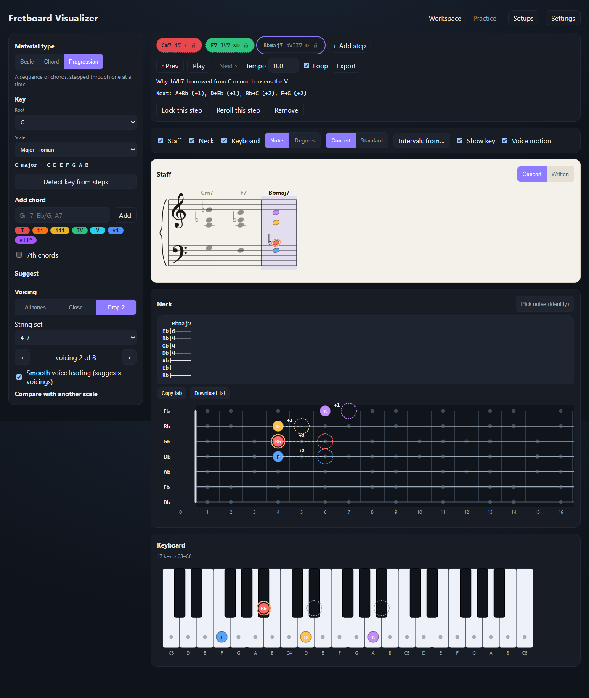
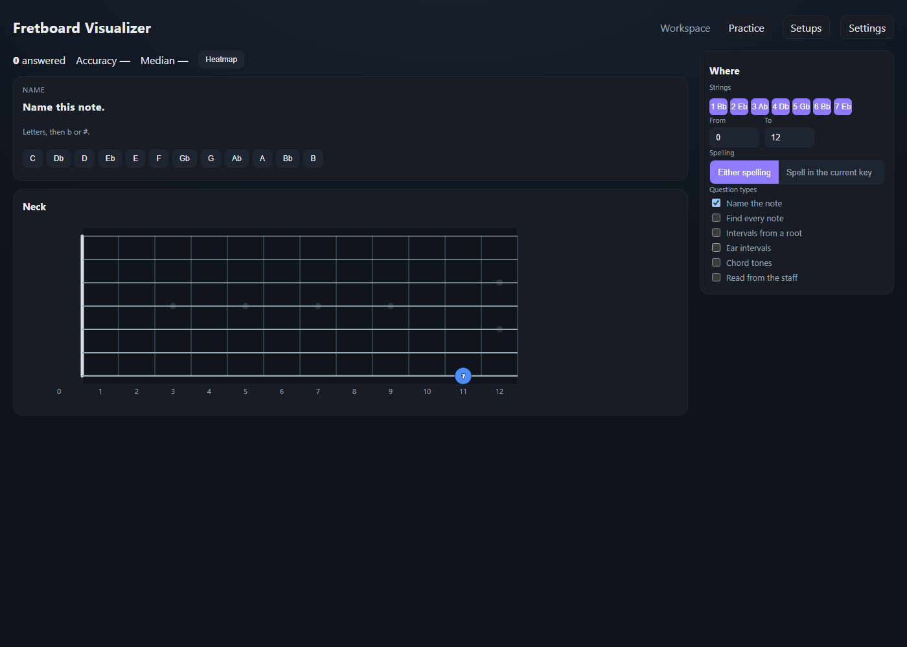

# Fretboard Visualizer

A workspace for scales, chords, and progressions on 6-string bass and 7- and 8-string guitars. The same notes are on the grand staff, the neck, and the keyboard, and a progression steps through them in time.



## Features

- **Material.** Scale, Chord, or Progression. The key is a root, a scale family, and a mode, with the spelled notes written out. Detect key ranks keys that fit the current steps.
- **Steps.** Type a symbol (Cm7, F7, Bbmaj7) or pick a diatonic chord from the palette. Each step shows its roman numeral and function. Suggest can fill a jazz ii–V–I, a pop loop, or a free functional line, and it says why. Lock a step to keep it.
- **Voicing.** All tones, Close, or Drop-2, on a chosen string set. Step through the playable voicings, or let smooth voice leading suggest a path. A voicing you pick yourself is left alone.
- **Views.** Staff, neck, and keyboard, together or one at a time. Labels are note names or degrees. Names are Concert (sounding) or Standard (one semitone higher, for half-step-down tuning); the frets do not move. The staff can show concert pitch or the written part.
- **Practice.** One quiz: name the note, find every note, intervals in both directions, ear intervals, chord tones, and reading the staff. The session remembers what you have answered.
- **Settings.** Instrument, tuning, handedness, which frets and strings are shown, the keyboard span, sound, MIDI in and out, and the voice-leading weights. Setups save a session, start a new one, or copy a link.

## How it is built

The page is one React app. `src/state/v2` holds the setup: material, steps, voicing, views, transport, settings, and practice. An older saved session is migrated when it is opened. `src/state/derive.ts` turns that setup into the scale, the spelling, and what each view should light.

`src/music` is the theory. It spells notes from the key after the Concert or Standard shift, builds chords, finds voicings on a string set, explains a step, and lays the same pitches on the staff and in tab. The views only draw what that layer returns.

The Workspace tab is the two columns in `src/components/layout`: material on the left, steps and the three views on the right. Practice is the other tab, one quiz with its own neck. Settings is a drawer, not a second copy of those controls.

Sound is a built-in synth plus Web MIDI. Export writes a MIDI file or guitar tab. The portable file `fretboard-visualizer.html` is the production build in one page.

## Getting started

```bash
npm install
npm run dev
```

Open the localhost URL Vite prints.

## Scripts

- `npm run dev` starts the Vite dev server.
- `npm run build` builds the app and writes `fretboard-visualizer.html`.
- `npm run preview` serves that build.
- `npm run typecheck` runs `tsc --noEmit`.
- `npm run test` runs the typecheck and Vitest.
- `npm run test:e2e` rebuilds the portable file and runs Playwright.

## Run it on another computer

`npm run build` writes `fretboard-visualizer.html`. Copy that file to the other computer and open it in a browser. Nothing else needs to be installed.

## Practice


